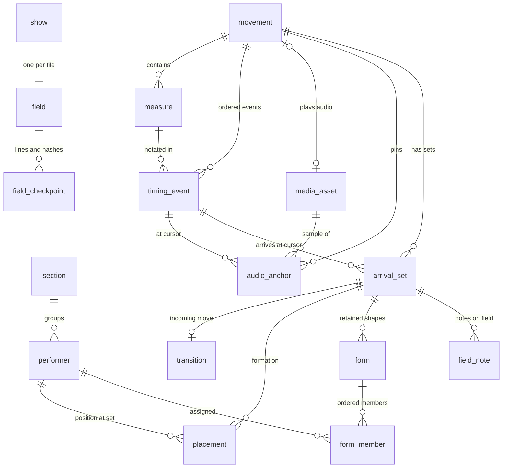

# The `.fieldwork` file: structure and schema

This document explains, field by field, what is inside a `.fieldwork` show file and how a reader or writer must treat it. It is a companion to the normative summary in [`spec/fieldwork-format.md`](../spec/fieldwork-format.md). Where they differ, the code in `packages/DrillDocument` is authoritative, and both documents should be fixed.

Covers: container format version **1.0**, database schema **4**.

Sources: `DocumentFormat.swift`, `ZipArchive.swift`, `ShowDatabase.swift`, `DocumentFile.swift` and `RecoveryJournal.swift` in `packages/DrillDocument/Sources/DrillDocument`, the model and validation in `packages/DrillCore`, and the timing model in `packages/DrillTiming`.

---

## 1. At a glance

A `.fieldwork` file is a plain ZIP archive. It holds one JSON manifest, one SQLite database and any embedded audio:

```
first-light.fieldwork            (ZIP, every member stored uncompressed)
├── manifest.json                identity, versions, capabilities, SHA-256 of every other member
├── show.sqlite                  the whole show: field, roster, timing, sets, positions, forms, notes
├── assets/
│   └── 62a868de…26ac0.wav       embedded audio, named by the SHA-256 of its bytes
└── extensions/                  optional; third-party or future data, kept byte-for-byte
    └── <namespace>/…
```

The layers depend on each other in one direction:

1. The **ZIP container** guarantees that each member is intact (CRC-32) and safe to extract (path rules, size limits).
2. The **manifest** says what the file is, which reader versions can open it, and the SHA-256 and size of every other member.
3. The **database** holds all show data. It references assets by content hash.
4. **Assets** are opaque bytes. They are valid only when their SHA-256 matches both their file name and the database row that points to them.

Everything is portable. The same bytes open on macOS, Windows and Linux, and there is no macOS bundle or directory package.

### Identity

The namespace is provisional and defined in one place, `FormatIdentity`:

| Constant | Value |
|---|---|
| Format identifier (`manifest.format`) | `org.fieldwork.show` |
| File extension | `fieldwork` |
| Uniform Type Identifier (macOS) | `org.fieldwork.show` |
| Current format version | `1.0` |
| Writer string | `Fieldwork 0.1.0` |
| Known capabilities | `drill.core.v1`, `timing.anchors.v1`, `media.audio.v1` |

---

## 2. The ZIP container

Fieldwork has its own ZIP implementation (`ZipArchive`). It uses a deliberately small subset of ZIP, so any standard tool can list and extract the file, but the Fieldwork reader accepts only what it can verify.

### Writer rules

| Property | Value written |
|---|---|
| Compression | Method 0 (stored) for every member |
| Version needed / made by | 20 |
| General-purpose flags | `0x0800` (names are UTF-8), never encrypted |
| Modification time and date | Fixed to `00:00:00` on `1980-01-01` (`time = 0`, `date = 0x0021`) |
| Extra fields and comments | None |
| Member order | `manifest.json`, then `show.sqlite`, then assets in database order, then `extensions/…` sorted by path |
| Archive comment | None |

Because timestamps are fixed and the order is deterministic, the same show always encodes to the same bytes.

### Reader rules

The reader finds the end-of-central-directory record, walks the central directory and rejects the file when any of these hold:

- The file is shorter than 22 bytes or has no end-of-central-directory record.
- The archive spans multiple disks, or uses ZIP64 (any size field equal to `0xFFFFFFFF`).
- It has more than **10,000** members, or the members add up to more than **2 GiB**.
- A member is encrypted (flag bit 0), uses any method other than 0, or has a compressed size different from its uncompressed size.
- A member name is not UTF-8, is duplicated, or its local header name does not match the central directory.
- Member data runs into the central directory.
- The CRC-32 of the member's bytes does not match.

### Path rules

Every member path, including those under `extensions/`, must:

- be non-empty and at most 512 bytes of UTF-8;
- be relative (no leading `/`);
- use `/` as the separator, and contain no `\`, `:` or NUL;
- have no empty, `.` or `..` components (so `a//b`, `./a` and `a/../b` are all rejected).

These rules prevent path traversal when a member is extracted to disk.

---

## 3. `manifest.json`

The manifest is UTF-8 JSON with sorted keys, pretty-printed. It is the only member that is not listed in itself. (Foundation's encoder escapes `/` as `\/`, which every JSON parser reads correctly.)

```json
{
  "capabilities" : [ "drill.core.v1", "timing.anchors.v1", "media.audio.v1" ],
  "extensions" : [ ],
  "format" : "org.fieldwork.show",
  "formatVersion" : { "major" : 1, "minor" : 0 },
  "members" : [
    { "bytes" : 184320, "path" : "show.sqlite",
      "sha256" : "492268f11542c4a9d03c2123427017bb6cf3beeb4807c4cf2235111f6d41d62c" },
    { "bytes" : 705644, "path" : "assets/62a868de2d5edb4f19ceaf6735bb051ed841f9017d99cf576b53b1249dd26ac0.wav",
      "sha256" : "62a868de2d5edb4f19ceaf6735bb051ed841f9017d99cf576b53b1249dd26ac0" }
  ],
  "minReaderVersion" : { "major" : 1, "minor" : 0 },
  "requiredCapabilities" : [ "drill.core.v1" ],
  "showID" : "AF529504-1B17-42C8-B201-DCF48B1968AB",
  "writer" : "Fieldwork 0.1.0"
}
```

| Key | Type | Meaning |
|---|---|---|
| `format` | string | Must be `org.fieldwork.show`. Anything else means the file is not a Fieldwork show. |
| `formatVersion` | `{major, minor}` | Version of the container format the writer used. |
| `minReaderVersion` | `{major, minor}` | Oldest reader version that can open the file. Version 1 writers write `1.0`. |
| `writer` | string | Free-form name and version of the writing application. For information only. |
| `showID` | string | The show's UUID, the same value as `show.id` in the database. |
| `capabilities` | string[] | Features the file uses. `drill.core.v1` and `timing.anchors.v1` are always present. `media.audio.v1` is added when the show has at least one media asset. |
| `requiredCapabilities` | string[] | Features a reader must understand before it may edit the file. Version 1 writes `["drill.core.v1"]`. |
| `members` | `{path, sha256, bytes}`[] | Every member except `manifest.json`. `sha256` is 64 lowercase hex characters. `bytes` is the exact length. |
| `extensions` | `{namespace, required}`[] | Extension namespaces present under `extensions/`, and whether each must be understood. |

### What a reader does with the manifest

1. **Wrong format:** if `format` is wrong or the JSON does not parse, it refuses: "not a Fieldwork show".
2. **Too new:** if `formatVersion.major` or `minReaderVersion.major` is greater than the reader's major version (1), it refuses with "saved in format X.Y, which is newer…". The file is not changed.
3. **Integrity:** every listed member must exist with the stated byte count and SHA-256. Any archive member that is neither `manifest.json` nor listed is damage. Both cases are refused as corrupt.
4. **Read-only:** if `requiredCapabilities` contains a capability the reader does not know, or any extension has `"required": true`, the show opens **read-only**, and the reason names the unknown features.
5. **Preserve:** members under `extensions/` are loaded as opaque bytes and written back unchanged on save, together with the `extensions` array.

Minor versions are forward compatible by design. A reader may open a newer minor version of the same major version.

---

## 4. Assets (`assets/<sha256>.<ext>`)

Embedded media is content-addressed:

- The file name is the lowercase hex SHA-256 of the bytes, followed by the lowercased original extension (`wav` or `mp3` in version 1).
- Each asset has one row in the `media_asset` table. The row's `sha256` and `extension` must reproduce the archive path exactly.
- On read, every `media_asset` row must have its member, and the member's hash must match. Otherwise the reader reports "the embedded file … is missing or damaged".
- On save, only assets referenced by a `media_asset` row are written. Bytes that no row references are dropped.
- Identical audio imported twice is stored once, because the path is derived from the content.

Audio is never modified or trimmed. Alignment is expressed through sample-frame anchors (see §6.5), not by editing the audio.

`preview.png` is a reserved member name for a future thumbnail. Version 1 neither writes nor requires it.

---

## 5. `show.sqlite`: conventions

`show.sqlite` is a complete SQLite 3 database file, produced with `sqlite3_serialize` from an in-memory database. It has no WAL or journal side files.

### Versioning

`PRAGMA user_version` holds the **schema version** (currently `4`). It is independent of the container format version. Schema changes happen inside format 1.0 and are handled by migration (see §8).

### Units and conventions

| Quantity | Unit and convention |
|---|---|
| Positions and lengths | **Meters**. The origin `(0, 0)` is field center. **+x** points to the audience's right, seen from the front stands. **+y** points toward the back sideline. **+z** points up. |
| Facing | **Degrees**. `0` faces the front sideline (the audience), and values increase **clockwise** seen from above. |
| Durations | **Seconds** (`REAL`). |
| Audio positions | **Sample frames** (`INTEGER`) at the asset's own sample rate. |
| Note values, fractions | **Exact rationals**, stored as an `_num` / `_den` integer pair. Note values are in whole notes, so `1/4` is a quarter note and `3/8` is a dotted quarter. The denominator must be greater than 0; a reader rejects anything else as corrupt. |
| Identifiers | **Uppercase UUID strings** (`8F0C1A2B-…`). They never change while the show is edited and are safe to reference from outside. |
| Booleans | `INTEGER` 0 or 1. |
| Order | Lists are ordered by an explicit `ordinal` column (0-based), never by `rowid`. The exceptions are `media_asset`, `audio_anchor` and `transition`, which are read in insertion order. |

Foreign keys are declared, and the writer runs `PRAGMA foreign_key_check` before serializing. The reader uses only fixed, prepared `SELECT` statements. It **never executes SQL stored in a document**.

---

## 6. `show.sqlite`: tables

### 6.1 Entity relationships



`meta` and `show` stand alone. Every table except `meta` and `show` is linked to the rest by foreign keys.

### 6.2 Full schema (version 4)

This is exactly the schema a current writer creates: schema 1, followed by the changes for schemas 2, 3 and 4.

```sql
-- Schema 1
CREATE TABLE meta (key TEXT PRIMARY KEY, value TEXT NOT NULL);
CREATE TABLE show (id TEXT PRIMARY KEY, title TEXT NOT NULL, max_stride REAL NOT NULL, min_clearance REAL NOT NULL);
CREATE TABLE field (singleton INTEGER PRIMARY KEY CHECK (singleton = 1), name TEXT NOT NULL, preset TEXT NOT NULL,
    length REAL NOT NULL, width REAL NOT NULL, step_size REAL NOT NULL, side_labels TEXT NOT NULL,
    front_label TEXT NOT NULL, back_label TEXT NOT NULL);
CREATE TABLE field_checkpoint (ordinal INTEGER PRIMARY KEY, axis TEXT NOT NULL CHECK (axis IN ('x','y')),
    position REAL NOT NULL, label TEXT NOT NULL, prominence TEXT NOT NULL);
CREATE TABLE media_asset (id TEXT PRIMARY KEY, sha256 TEXT NOT NULL, extension TEXT NOT NULL, original_filename TEXT NOT NULL,
    byte_count INTEGER NOT NULL, sample_rate REAL NOT NULL, frame_count INTEGER NOT NULL, channel_count INTEGER NOT NULL);
CREATE TABLE section (id TEXT PRIMARY KEY, ordinal INTEGER NOT NULL, name TEXT NOT NULL, prefix TEXT NOT NULL,
    symbol TEXT NOT NULL, color_index INTEGER NOT NULL);
CREATE TABLE performer (id TEXT PRIMARY KEY, ordinal INTEGER NOT NULL, label TEXT NOT NULL UNIQUE,
    section_id TEXT NOT NULL REFERENCES section(id), name TEXT, notes TEXT NOT NULL);
CREATE TABLE movement (id TEXT PRIMARY KEY, ordinal INTEGER NOT NULL, name TEXT NOT NULL,
    audio_asset_id TEXT REFERENCES media_asset(id), fit_mode TEXT NOT NULL);
CREATE TABLE measure (id TEXT PRIMARY KEY, movement_id TEXT NOT NULL REFERENCES movement(id), ordinal INTEGER NOT NULL,
    number INTEGER NOT NULL, meter_numerator INTEGER NOT NULL, meter_denominator INTEGER NOT NULL, grouping TEXT,
    tempo_unit_num INTEGER NOT NULL, tempo_unit_den INTEGER NOT NULL, pulse_unit_num INTEGER NOT NULL, pulse_unit_den INTEGER NOT NULL,
    pickup_num INTEGER, pickup_den INTEGER);
CREATE TABLE timing_event (id TEXT PRIMARY KEY, movement_id TEXT NOT NULL REFERENCES movement(id), ordinal INTEGER NOT NULL,
    kind TEXT NOT NULL CHECK (kind IN ('beat','hold')), measure_id TEXT NOT NULL REFERENCES measure(id), beat_index INTEGER NOT NULL,
    notated_num INTEGER NOT NULL, notated_den INTEGER NOT NULL, baseline_seconds REAL NOT NULL CHECK (baseline_seconds > 0));
CREATE TABLE audio_anchor (id TEXT PRIMARY KEY, movement_id TEXT NOT NULL REFERENCES movement(id),
    event_id TEXT NOT NULL REFERENCES timing_event(id), fraction_num INTEGER NOT NULL, fraction_den INTEGER NOT NULL,
    asset_id TEXT NOT NULL REFERENCES media_asset(id), sample_frame INTEGER NOT NULL, sample_rate REAL NOT NULL, locked INTEGER NOT NULL);
CREATE TABLE arrival_set (id TEXT PRIMARY KEY, movement_id TEXT NOT NULL REFERENCES movement(id), ordinal INTEGER NOT NULL,
    label TEXT NOT NULL, event_id TEXT NOT NULL REFERENCES timing_event(id), fraction_num INTEGER NOT NULL, fraction_den INTEGER NOT NULL,
    is_subset INTEGER NOT NULL, notes TEXT NOT NULL);
CREATE TABLE transition (id TEXT PRIMARY KEY, to_set_id TEXT NOT NULL UNIQUE REFERENCES arrival_set(id), model TEXT NOT NULL);
CREATE TABLE placement (set_id TEXT NOT NULL REFERENCES arrival_set(id), performer_id TEXT NOT NULL REFERENCES performer(id),
    state TEXT NOT NULL CHECK (state IN ('placed','unresolved','inactive')), x REAL, y REAL, z REAL, facing REAL,
    PRIMARY KEY (set_id, performer_id));
CREATE TABLE form (id TEXT PRIMARY KEY, set_id TEXT NOT NULL REFERENCES arrival_set(id), ordinal INTEGER NOT NULL,
    kind TEXT NOT NULL CHECK (kind IN ('line','arc')), x0 REAL NOT NULL, y0 REAL NOT NULL, x1 REAL NOT NULL, y1 REAL NOT NULL, bulge REAL NOT NULL);
CREATE TABLE form_member (form_id TEXT NOT NULL REFERENCES form(id), ordinal INTEGER NOT NULL,
    performer_id TEXT NOT NULL REFERENCES performer(id), PRIMARY KEY (form_id, ordinal));

-- Schema 2
ALTER TABLE show ADD COLUMN counting_mode TEXT NOT NULL DEFAULT 'measures' CHECK (counting_mode IN ('measures','counts'));
ALTER TABLE arrival_set ADD COLUMN rehearsal_mark TEXT NOT NULL DEFAULT '';
ALTER TABLE arrival_set ADD COLUMN measure_marker TEXT NOT NULL DEFAULT '';

-- Schema 3
ALTER TABLE performer ADD COLUMN symbol TEXT;

-- Schema 4
CREATE TABLE field_note (id TEXT PRIMARY KEY, set_id TEXT NOT NULL REFERENCES arrival_set(id), ordinal INTEGER NOT NULL,
    x REAL NOT NULL, y REAL NOT NULL, text TEXT NOT NULL);

PRAGMA user_version = 4;
```

Because schemas 2 and 3 add columns with `ALTER TABLE`, those columns come **last** in their tables. The writer inserts rows positionally, so the column order above is part of the format.

### 6.3 Show, metadata and field

#### `meta`

Key/value strings. A current writer writes exactly:

| key | value |
|---|---|
| `writer` | Writer string, for example `Fieldwork 0.1.0` |
| `units` | `meters` |

Readers do not interpret `meta`. It is for diagnostics.

#### `show` (exactly one row)

| Column | Type | Meaning |
|---|---|---|
| `id` | TEXT UUID | Show identity. Equal to `manifest.showID`. |
| `title` | TEXT | Display title. |
| `max_stride` | REAL m | Analysis threshold: the largest step per count before a stride warning. For example, `0.762` m is 6-to-5. |
| `min_clearance` | REAL m | Analysis threshold: the closest two performers may pass before a close-pass warning. |
| `counting_mode` | TEXT | `measures`: set positions are shown as measures and beats. `counts`: sets are pages of counts, and measure numbers are author-supplied markers. Any other value is rejected as corrupt. |

Analysis thresholds are design aids. They never move drill.

#### `field` (exactly one row, `singleton = 1`)

| Column | Type | Meaning |
|---|---|---|
| `name` | TEXT | Display name, for example `High school football`. |
| `preset` | TEXT | `highSchoolFootball`, `collegeFootball`, `proFootball`, `indoorFloor` or `custom`. Unknown values are read as `custom`. The preset is a label only; the stored dimensions and checkpoints always win. |
| `length` | REAL m | Side-to-side extent (x). Valid range 2–1000. |
| `width` | REAL m | Front-to-back extent (y). Valid range 2–1000. |
| `step_size` | REAL m | One marching step. 8-to-5 is `0.5715`. It must be greater than 0.05 and less than 5. |
| `side_labels` | TEXT (JSON) | A JSON array of labels for the audience-left and audience-right halves, for example `["S1","S2"]`. |
| `front_label` | TEXT | Word used for the front side in coordinate descriptions, for example `front`. |
| `back_label` | TEXT | Word used for the back side, for example `back`. |

The field occupies `x ∈ [−length/2, +length/2]` and `y ∈ [−width/2, +width/2]`.

#### `field_checkpoint`

Reference lines used for drawing and for coordinate descriptions such as "S1: 4.00 outside 35".

| Column | Type | Meaning |
|---|---|---|
| `ordinal` | INTEGER PK | Order (0-based). |
| `axis` | TEXT | `x`: a line of constant x (a yard line), which describes side-to-side position. `y`: a line of constant y (a sideline or hash), which describes front-to-back position. |
| `position` | REAL m | The constant coordinate of the line. |
| `label` | TEXT | For example `G`, `35`, `front hash`, `back sideline`. |
| `prominence` | TEXT | `major`, `minor` or `hash`, which sets how strongly the line is drawn. Other values are rejected. |

### 6.4 Roster

#### `section`

| Column | Type | Meaning |
|---|---|---|
| `id` | TEXT UUID | |
| `ordinal` | INTEGER | Display order. |
| `name` | TEXT | For example `Trumpet`. |
| `prefix` | TEXT | Prefix for drill labels, for example `T`. |
| `symbol` | TEXT | `circle`, `cross`, `square`, `triangle`, `diamond` or `slash`. Unknown values are read as `circle`. |
| `color_index` | INTEGER | Index into `sectionPalette` in [`design/tokens.json`](../design/tokens.json), which has 10 entries. Frontends wrap the index modulo the palette length. It is not a raw color. |

#### `performer`

| Column | Type | Meaning |
|---|---|---|
| `id` | TEXT UUID | Stable identity. Positions and forms reference it, never the label. |
| `ordinal` | INTEGER | Roster order. |
| `label` | TEXT UNIQUE | Drill label, for example `T1`. Unique across the show. |
| `section_id` | TEXT → `section.id` | Must exist. |
| `name` | TEXT NULL | Private roster data (a student's name). Exports may remove it. |
| `notes` | TEXT | Free text, empty when unused. |
| `symbol` | TEXT NULL | *(schema 3)* Overrides the section's symbol for this performer. NULL means the section's symbol is used. |

### 6.5 Timing: movements, measures, events and anchors

The timeline separates **notation** (measures, meters), **march counts** (pulses) and **recorded time** (audio samples). Tempo is never stored as its own value. It is compiled into the event durations.

#### `movement`

| Column | Type | Meaning |
|---|---|---|
| `id` | TEXT UUID | |
| `ordinal` | INTEGER | Order. A show has at least one movement. |
| `name` | TEXT | For example `Movement 1`. |
| `audio_asset_id` | TEXT NULL → `media_asset.id` | The movement's playback audio. NULL means counts-only. |
| `fit_mode` | TEXT | `preserveAudioPins`: tempo edits refit durations between pins, and pinned timestamps never move. `preserveNotatedTempo`: tempo is kept, and edits inside a pinned interval are conflicts the user must resolve. Unknown values are read as `preserveAudioPins`. |

#### `measure`

| Column | Type | Meaning |
|---|---|---|
| `id` | TEXT UUID | |
| `movement_id` | TEXT → `movement.id` | |
| `ordinal` | INTEGER | Order within the movement. |
| `number` | INTEGER | **Display** label only. A pickup is `0`. Identity comes from `id` and order from `ordinal`. |
| `meter_numerator`, `meter_denominator` | INTEGER | For example `6`, `8`. Both must be positive, and the denominator must be a power of two. |
| `grouping` | TEXT NULL | Beat groups in denominator units, joined with `+`, for example `3+2` for 5/8. The groups must add up to the numerator. When present, groups define the march counts. |
| `tempo_unit_num/_den` | INTEGER pair | The note value the tempo refers to, for example `3/8` for dotted-quarter = 80. |
| `pulse_unit_num/_den` | INTEGER pair | The note value of one march count when there is no `grouping`. For example, 6/8 counted in 2 uses `3/8`, and counted in 6 uses `1/8`. |
| `pickup_num/_den` | INTEGER pair, NULL | If set, the measure is a pickup this many whole notes long, shorter than its meter. Counts are aligned backwards from the next bar line. |

**March counts in a measure** start at these offsets from the bar line:

- with `grouping`: at the running sums of `group × (1/denominator)`;
- in a pickup: at `pickup − k × pulse_unit`, counted backwards and clamped at 0;
- otherwise: at multiples of `pulse_unit`.

A measure contributes as many counts as it has start offsets. Counts run continuously from **0** at the start of the movement.

#### `timing_event`

The ordered **performance events** of a movement. Cursors, anchors and sets all reference events.

| Column | Type | Meaning |
|---|---|---|
| `id` | TEXT UUID | Stable; it survives renumbering. |
| `movement_id` | TEXT → `movement.id` | |
| `ordinal` | INTEGER | Performance order. Events of a measure are contiguous, and measures appear in measure order. |
| `kind` | TEXT | `beat`: a notated beat that advances notation and counts. `hold`: elapsed time with **no** notated or count advance, such as a fermata or caesura. |
| `measure_id` | TEXT → `measure.id` | The measure this event belongs to. |
| `beat_index` | INTEGER | 0-based beat within the measure, so `m17 b1` is `beat_index = 0`. A hold is inserted right after the beat it extends and repeats that beat's `measure_id` and `beat_index`. |
| `notated_num/_den` | INTEGER pair | Notated length in whole notes, for example `1/4`. It must be greater than 0 for beats. Holds store `0/1`. |
| `baseline_seconds` | REAL > 0 | Unfitted duration compiled from tempo. For a constant tempo, `seconds = (notated / tempo_unit) × 60 / BPM`. Linear tempo ramps are integrated exactly into these values. |

#### Cursors

Several tables locate a point in time as a **cursor**: `(event_id, fraction_num/fraction_den)`, with `0 ≤ fraction ≤ 1`.

- The fraction is the position through the event. `0` is its start, and `1/2` is halfway.
- At a boundary, the canonical form is the **next** event at fraction 0, not the previous event at fraction 1.
- Cursors are exact rationals, so a set at "count 12" never drifts through floating-point rounding.

#### `audio_anchor`

An anchor pins a cursor to an exact sample of an audio asset.

| Column | Type | Meaning |
|---|---|---|
| `id` | TEXT UUID | |
| `movement_id` | TEXT → `movement.id` | |
| `event_id`, `fraction_num/_den` | cursor | The musical position being pinned. |
| `asset_id` | TEXT → `media_asset.id` | The audio the sample frame refers to. Only anchors whose `asset_id` equals the movement's `audio_asset_id` take part in fitting. |
| `sample_frame` | INTEGER | Frame index in the source file. |
| `sample_rate` | REAL Hz | The source's sample rate. The anchor's time is `sample_frame / sample_rate` seconds. The output device rate never changes this value. |
| `locked` | INTEGER bool | The pin is locked against accidental edits. |

**How the time map is built** (`TimingMap`):

1. **No audio, or no anchors:** audio time equals cumulative `baseline_seconds` from the start of the movement.
2. **One anchor:** sets the offset. Baseline durations run forward and backward from it.
3. **Two or more anchors**, sorted by cursor: for each consecutive pair, every `beat` duration between them is multiplied by one common **scale**, so the interval matches the audio time. `hold` durations stay fixed. The scale is `(elapsed − fixed) / elastic` and must lie within **[1/3, 3]**.
4. Outside the pinned range, baseline durations continue from the nearest anchor.
5. The resulting map from cursor to audio time is continuous and strictly increasing, and it has an exact inverse.
6. A negative mapped time means **pre-roll**, that is, silence before the file starts. It is not a negative seek.

A writer must not save anchors that violate these rules: two anchors at the same musical position, a later cursor at an earlier or equal timestamp, no elastic time between anchors, or a scale outside [1/3, 3]. Fieldwork refuses such edits as conflicts instead of resolving them silently.

**Example:** in 4/4 at quarter = 120, pin m1 b1 at 12.400 s. Without a second pin, m17 b1 is at 44.400 s. Pinning m17 b1 at 44.600 s instead gives 32.200 s over 64 beats, a scale of 1.00625, or about 119.255 BPM. No set coordinate or musical position changes.

#### `media_asset`

| Column | Type | Meaning |
|---|---|---|
| `id` | TEXT UUID | |
| `sha256` | TEXT | Lowercase hex digest of the bytes. |
| `extension` | TEXT | Lowercased, for example `wav`. The archive path is `assets/<sha256>.<extension>`. |
| `original_filename` | TEXT | The imported file's name, shown to the user. |
| `byte_count` | INTEGER | Size in bytes. |
| `sample_rate` | REAL Hz | Decoded sample rate. |
| `frame_count` | INTEGER | Decoded length in frames. Duration is `frame_count / sample_rate`. |
| `channel_count` | INTEGER | For example `1` for mono. |

### 6.6 Drill: sets, moves, positions, forms and notes

#### `arrival_set`

An **arrival set** is an exact formation at a cursor. The move *into* it is a separate `transition`.

| Column | Type | Meaning |
|---|---|---|
| `id` | TEXT UUID | |
| `movement_id` | TEXT → `movement.id` | |
| `ordinal` | INTEGER | Show-wide order. Within a movement, sets must arrive at strictly increasing counts. |
| `label` | TEXT | For example `1`, `2A`. |
| `event_id`, `fraction_num/_den` | cursor | The arrival time. |
| `is_subset` | INTEGER bool | A named intermediate arrival boundary. |
| `notes` | TEXT | Free text. |
| `rehearsal_mark` | TEXT | *(schema 2)* For example `A`, `CC`. Empty when unused. Display only. |
| `measure_marker` | TEXT | *(schema 2)* Free text such as `222-223`. Empty when unused. Display only. |

The **first set of each movement is the preset** (count 0 by convention). It has no incoming transition, and every later set has exactly one. Rehearsal marks and measure markers never move a set.

#### `transition`

| Column | Type | Meaning |
|---|---|---|
| `id` | TEXT UUID | |
| `to_set_id` | TEXT UNIQUE → `arrival_set.id` | The set this move arrives at. The move starts at the previous set in the same movement. |
| `model` | TEXT | Version 1 has only `straight`: constant-speed straight travel over the move's counts. Unknown values are read as `straight`. |

#### `placement`

The **authoritative** position of each performer at each set.

| Column | Type | Meaning |
|---|---|---|
| `set_id` | TEXT → `arrival_set.id` | Part of the primary key. |
| `performer_id` | TEXT → `performer.id` | Part of the primary key. |
| `state` | TEXT | `placed`: has a position. `unresolved`: no position decided yet. `inactive`: not on the field at this set. Unknown values are read as `unresolved`. |
| `x`, `y`, `z` | REAL m, NULL | Set only when `state = 'placed'`. `x` and `y` are required for `placed`, and a NULL is rejected as corrupt. |
| `facing` | REAL °, NULL | Set only when `placed`. |

- A **missing row** for a `(set, performer)` pair means **unresolved**.
- Fieldwork never invents `(0, 0)` for missing data. New performers start unresolved.
- All placed values must be finite numbers.

#### `form` and `form_member`

A form keeps the **control geometry** and **assignment order** of a shape, so it stays editable as a shape. Performer positions are still stored in `placement`, and `placement` wins on read. Forms do not regenerate positions when a file is loaded.

| `form` column | Type | Meaning |
|---|---|---|
| `id` | TEXT UUID | |
| `set_id` | TEXT → `arrival_set.id` | A form belongs to one set. |
| `ordinal` | INTEGER | Show-wide order. |
| `kind` | TEXT | `line` or `arc`. |
| `x0`, `y0` | REAL m | Start point. |
| `x1`, `y1` | REAL m | End point. |
| `bulge` | REAL m | For `arc`, the signed **sagitta** (the distance from the chord's midpoint to the arc). A positive value bulges to the **left** of the start→end direction. `0` for lines. |

| `form_member` column | Type | Meaning |
|---|---|---|
| `form_id` | TEXT → `form.id` | Part of the primary key. |
| `ordinal` | INTEGER | Part of the primary key. Position in the assignment order along the form, from start to end. |
| `performer_id` | TEXT → `performer.id` | No duplicates within a form. A performer is in **at most one form per set**. |

Members are distributed at equal **arc length** along the form, with both endpoints included. A single member sits at the midpoint. "Reverse order" reverses the ordinals.

#### `field_note` *(schema 4)*

A text box drawn on the field at one set. Notes are reminders for the author and never affect drill.

| Column | Type | Meaning |
|---|---|---|
| `id` | TEXT UUID | |
| `set_id` | TEXT → `arrival_set.id` | The set the note is shown at. |
| `ordinal` | INTEGER | Show-wide order. |
| `x`, `y` | REAL m | Top-left corner of the box. Must be finite. |
| `text` | TEXT | At most 2,000 characters. |

---

## 7. Invariants a valid file satisfies

The writer validates the whole show before encoding, and the reader validates it again after decoding. A file that breaks any of these is reported as damaged: "the show data is inconsistent".

**Field**

- Length and width are in [2, 1000] m, and the step size is in (0.05, 5) m.

**Roster**

- Section, performer, set and note IDs are unique within their tables.
- Performer labels are unique, and every performer's section exists.

**Timing**

- There is at least one movement, and every movement has at least one timing event.
- Event IDs are unique, every event's measure exists, and measures appear in order in the event sequence.
- Every `baseline_seconds` is finite and greater than 0, and every beat has a notated duration greater than 0.
- Every anchor's event exists, and the anchors fit (§6.5).
- A movement's `audio_asset_id`, if set, exists.

**Sets and moves**

- Every movement has at least one set, which is its preset.
- Every set's cursor exists, and its fraction is in [0, 1].
- Within a movement, sets arrive at strictly increasing counts.
- The preset has no transition. Every other set has exactly one, and no set has two.

**Positions, forms and notes**

- Placements reference existing sets and performers, and placed coordinates and facing are finite.
- Forms reference an existing set, their members are unique existing performers, and no performer is in two forms on the same set.
- Notes reference an existing set, have finite positions and contain at most 2,000 characters.

**References**

- `PRAGMA foreign_key_check` returns nothing.

---

## 8. Schema history and migration

| Schema | Change | Default for old files |
|---|---|---|
| 1 | Initial tables (§6.2, "Schema 1") | — |
| 2 | `show.counting_mode`; `arrival_set.rehearsal_mark`, `arrival_set.measure_marker` | `measures`, `''`, `''` |
| 3 | `performer.symbol` | NULL (follow the section) |
| 4 | New `field_note` table | Empty |

When opening a file:

1. The reader loads `show.sqlite` into **memory**.
2. If `user_version` is **greater** than the reader's schema, it refuses: "schema N is newer than this version supports". The file is not changed.
3. If it is lower, the reader applies each step `v → v+1` in its own transaction on the in-memory copy, then reads the result. The archive on disk is **never touched**.
4. The next save writes a fresh schema 4 database.

`examples/first-light.fieldwork` is currently a schema 1 file. It has no `counting_mode`, `rehearsal_mark`, `measure_marker`, `symbol` or `field_note`, and it opens through this migration path.

Format-level (manifest) changes and schema-level changes are separate. Adding a table or column is a schema bump within format 1.x. Only a change that old readers cannot open safely bumps `formatVersion.major`.

---

## 9. Reading and writing, step by step

### Decode (`DocumentCodec.decode`)

1. Read and verify the ZIP (§2).
2. Parse `manifest.json` and check the format and version (§3).
3. Verify each listed member's byte count and SHA-256, and reject unlisted members.
4. Open `show.sqlite`, migrate it in memory, read every table with prepared queries, and validate (§7).
5. Load each asset named by `media_asset` and check its hash.
6. Keep `extensions/…` members as opaque bytes.
7. Mark the show read-only if a required capability or extension is unknown.

### Encode (`DocumentCodec.encode`)

1. Validate the show.
2. Build a fresh schema 4 database in memory, insert all rows, run `foreign_key_check` and serialize.
3. Collect referenced assets and confirm their hashes.
4. Append extension members, sorted by path.
5. Write the manifest, including the hash of every member, then the ZIP with the manifest first.

### Save to disk (`DocumentFile.save`)

1. Encode, then **decode the new bytes** as a check. If the check fails, the save is cancelled and the existing file is left unchanged.
2. Write to a hidden sibling temporary file (`.<name>.<uuid>.tmp`) and flush it to disk.
3. Atomically replace the target, keeping the previous file as **`<name>.fieldwork.previous`**. Windows uses `ReplaceFileW`; POSIX systems hard-link the old file to the backup, then `rename`.

On macOS the app saves through `NSDocument` and uses only `DocumentCodec`, so exactly one writer ever replaces a document.

---

## 10. What is *not* in the file

- **View state:** selection, hover, zoom and pan, panel sizes, visible timeline range, playback position and tour progress. These are per-user local settings.
- **Undo history:** it is in memory only and is not saved.
- **Derived data:** analysis warnings, waveform peaks, fitted tempo reports and intermediate positions. All are recomputed from the stored data.
- **A separate tempo value:** tempo exists only as compiled `baseline_seconds`.
- **The recovery journal**, described next.

### Recovery journal (alongside the document, never inside it)

While a show is open, the app keeps a per-session recovery directory:

| File | Contents |
|---|---|
| `base.fieldwork` | A full `.fieldwork` snapshot, taken at open, at creation and after every save |
| `assets/` | Audio imported since that snapshot, named like archive assets |
| `journal.jsonl` | One line per committed edit: `{"v":1,"event":<CommitEvent>}` |

After a crash, recovery opens the base snapshot, adds the extra assets and replays complete lines in order. A torn **last** line is ignored and reported. A bad line anywhere else, or a line with `v` greater than 1, counts as damage. The recovered show is marked unsaved, and the user's own document file is never modified by recovery. A clean close deletes the directory.

---

## 11. Inspecting a file by hand

Any ZIP tool and the `sqlite3` CLI are enough:

```sh
unzip -l show.fieldwork                       # list members (all "Stored")
unzip -p show.fieldwork manifest.json         # print the manifest
unzip -p show.fieldwork show.sqlite > show.sqlite
sqlite3 show.sqlite 'PRAGMA user_version; .tables'
sqlite3 show.sqlite "SELECT s.label, p.label, pl.state, pl.x, pl.y
                     FROM placement pl
                     JOIN arrival_set s ON s.id = pl.set_id
                     JOIN performer p ON p.id = pl.performer_id
                     ORDER BY s.ordinal, p.ordinal;"
```

Or use the bundled tool:

```sh
cd packages/DrillBridge
swift run -c release fwtool info ../../examples/first-light.fieldwork
```

To **modify** a file outside Fieldwork, rebuild it according to the writer rules. Store members uncompressed, recompute every SHA-256 and byte count in the manifest, keep the hash-based asset names and make sure §7 still holds. Otherwise Fieldwork will refuse the file as damaged. It will not try to repair it.
